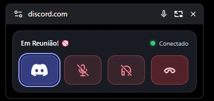
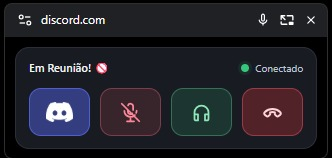
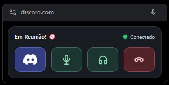

<div align="center">

# Discontrol

**Sua chamada de voz sempre ao alcance de um clique.**

Uma extensão leve para controlar chamadas do **Discord Web e Micup Web** em uma janela flutuante, sem precisar alternar constantemente de aba.

[](https://github.com/vsantus/discontrol)
[](https://www.google.com/chrome/)
[](https://www.typescriptlang.org/)
[](./LICENSE)

**[Como instalar](#-instalação)** · **[Funcionalidades](#-funcionalidades)** · **[Como usar](#-como-usar)** · **[Histórico](#-histórico-de-versões)**

</div>

---

## ✨ Conheça o Discontrol

O **Discontrol** traz os principais controles de uma chamada de voz para um painel compacto usando a **Document Picture-in-Picture API** do Chrome. Assim, você pode continuar programando, estudando ou navegando enquanto acompanha a conexão e controla o áudio do Discord Web ou Micup Web.

A interface mostra o **canal atual à esquerda**, o **status da conexão à direita** e quatro ações rápidas para voltar à guia de origem, ativar/desativar o microfone, ativar/desativar o áudio e desconectar. A extensão identifica a plataforma pela URL da guia em que foi aberta.

O painel solicita uma área de conteúdo inicial de **267 × 100 px**, com fundo preto. A barra superior do Chrome ocupa espaço adicional.

### Prévia da interface — versão 0.6.x

| Microfone e áudio desativados | Áudio ativo, microfone desativado | Microfone e áudio ativos |
| :---: | :---: | :---: |
|  |  |  |

> Estas capturas mostram a interface anterior no Discord Web. A versão 0.7.0-test.9 tem fundo preto sem card interno, suporte ao Micup e novo ícone da extensão com controle e microfone.

## ⚡ Funcionalidades

| Recurso | Como funciona |
| --- | --- |
| **Janela flutuante** | O painel permanece visível sobre outras janelas por meio de Picture-in-Picture. |
| **Nome do canal** | Exibe o canal de voz conectado, quando identificado na interface do serviço. |
| **Status da chamada** | Indica conexão detectada, detecção parcial ou chamada não identificada. |
| **Microfone** | Ativa ou silencia o microfone com indicação visual do estado. |
| **Áudio** | Ativa ou silencia a saída de áudio da chamada, também com indicação visual. |
| **Desconectar** | Sai do canal de voz a partir do painel. |
| **Voltar à guia** | Retorna à aba original com um clique. |

## 📦 Instalação

### Opção 1 — Importar um pacote pronto

Se você recebeu um pacote como `discontrol-0.7.0-test.9.zip`, ele já contém a extensão compilada.

1. Extraia o ZIP para uma pasta fixa no computador.
2. Abra `chrome://extensions` no Google Chrome.
3. Habilite o **Modo do desenvolvedor**, no canto superior direito.
4. Clique em **Carregar sem compactação**.
5. Selecione a pasta **`discontrol-test`**, que contém `manifest.json`, `background.js` e a pasta `icons`.
6. No menu de extensões, indicado pela peça de quebra-cabeça, fixe o **Discontrol**.

Mantenha a pasta extraída no computador enquanto usar a extensão.

### Opção 2 — Compilar o código-fonte

O ZIP do botão **Code → Download ZIP** do GitHub contém o código-fonte. Compile o projeto para gerar a pasta carregável.

Instale Node.js e npm. Para clonar pelo terminal, instale também o Git.

```bash
git clone https://github.com/vsantus/discontrol.git
cd discontrol
npm install
npm run typecheck
npm run build
```

Se baixou pelo botão **Download ZIP**, extraia o arquivo e abra o terminal na pasta que contém `package.json`. Execute os três comandos `npm` acima.

Depois, abra `chrome://extensions`, ative o **Modo do desenvolvedor**, clique em **Carregar sem compactação** e selecione a pasta **`dist`** gerada.

| Origem | Pasta para carregar no Chrome |
| --- | --- |
| Pacote pronto `discontrol-0.7.0-test.9.zip` | `discontrol-test` |
| Código-fonte após `npm run build` | `dist` |

A pasta escolhida deve conter `manifest.json` e `background.js`.

### Atualizar a extensão

1. Feche a janela flutuante.
2. Substitua os arquivos na pasta já carregada pelo novo pacote extraído. Se usa o código-fonte, atualize o código e execute `npm install` e `npm run build`.
3. Abra `chrome://extensions` e clique em **Recarregar** no cartão do Discontrol.
4. Na guia da chamada, clique novamente no ícone da extensão.

Se mudar a pasta de instalação, remova a extensão antiga e carregue a nova pasta em **Carregar sem compactação**.

### Problemas comuns

| Situação | O que conferir |
| --- | --- |
| Manifesto não encontrado | Extraia o ZIP e selecione a pasta que contém `manifest.json`. |
| Erro ao carregar `background.js` | Compile com `npm run build` e selecione `dist`. |
| Clique sem abrir o painel | Abra a chamada em uma guia de `discord.com/channels/…`, `discord.com/app` ou `micup.gg/channels/…`. |
| Visual antigo após atualizar | Recarregue a extensão e feche e reabra o painel. |

## 🎮 Como usar

1. Abra o [Discord Web](https://discord.com/app) ou o [Micup Web](https://micup.gg/channels/@me) no Chrome.
2. Entre em um canal de voz.
3. Clique no ícone do **Discontrol** na barra do navegador.
4. Controle sua chamada pela janela flutuante.

Cada painel controla a guia em que foi aberto. Com os dois serviços abertos, clique na extensão na guia da chamada que deseja controlar.

| Indicador | Significado |
| --- | --- |
| 🟢 Verde | Controles da chamada detectados. |
| 🟡 Amarelo | Detecção parcial dos controles. |
| ⚪ Cinza | Nenhuma chamada detectada. |

Os controles de microfone e fones ficam destacados conforme o estado identificado na página. Se algum controle não puder ser reconhecido, ele é desabilitado para evitar ações incorretas.

## 🛠️ Tecnologias

- **TypeScript** — implementação da extensão e sincronização dos controles.
- **Chrome Extensions Manifest V3** — integração com o navegador.
- **Document Picture-in-Picture API** — janela flutuante.
- **DOM API e MutationObserver** — observação das interfaces do Discord Web e Micup Web.

O projeto não precisa de backend, banco de dados ou conta adicional.

## ⚠️ Requisitos e limitações

- Requer **Google Chrome 116 ou superior**.
- Integração com **Discord Web e Micup Web**, abertos no Chrome.
- A guia de origem precisa permanecer aberta enquanto o PiP estiver em uso.
- O painel permanece aberto ao voltar à guia da chamada. Para reabri-lo após fechar, clique novamente na extensão.
- A integração utiliza elementos e atributos acessíveis da página. Mudanças na interface ou no idioma dos serviços podem exigir manutenção. O Micup foi validado inicialmente com a interface em português.
- O nome do canal pode aparecer como indisponível quando a extensão não conseguir identificá-lo com segurança.
- A extensão não implementa telemetria própria nem precisa enviar informações da chamada a servidores externos.

## 🗒️ Histórico de versões

Versão atual **0.7.0-test.9**. O manifesto usa `version: 0.7.0` e `version_name: 0.7.0-test.9` para identificar a revisão de teste.

| Versão | Principais mudanças |
| --- | --- |
| **0.7.0-test.9 — atual** | Símbolo do Micup maior e ícone da extensão com controle e microfone lado a lado, sem cantos brancos. |
| 0.7.0-test.8 | Logo transparente do Micup no botão de retorno à guia. |
| 0.7.0-test.7 | Novo ícone da extensão com controle e microfone em 16, 32, 48 e 128 px. |
| 0.7.0-test.6 | Restauração do estilo anterior do botão e imagem roxa do Micup. |
| 0.7.0-test.5 | Experimento com botão do Micup preto e borda branca. |
| 0.7.0-test.4 | Ícone do Micup no botão de retorno à guia. |
| 0.7.0-test.3 | Tamanho inicial solicitado de 267 × 100 px para o conteúdo. |
| 0.7.0-test.2 | Fundo preto contínuo e remoção do card interno. |
| 0.7.0-test.1 | Suporte ao Micup Web, identificação automática da plataforma e adaptadores dos controles de voz. |
| **0.6.3** | Correção da identificação do nome do canal pelo campo `Canal / Servidor`. |
| **0.6.2** | Nome do canal à esquerda e status da chamada à direita. |
| **0.6.1** | Correção do ícone de retorno ao Discord no PiP. |
| 0.6.0 | Identidade visual própria com monograma D e microfone desativado. |
| 0.5.0 | Rebranding do projeto para **Discontrol**, by devsantos. |
| 0.4.x | Interface minimalista, refinamento dos ícones e sincronização dos estados de microfone/áudio. |
| 0.3.x | Botões com ícones e evolução da detecção dos controles do Discord. |
| 0.2.x | Primeiros controles de chamada e ferramentas de diagnóstico. |
| 0.1.0 | Protótipo funcional de Picture-in-Picture. |

## 👨‍💻 Autor

Desenvolvido por **[devsantos](https://github.com/vsantus)**.

Gostou do projeto? Uma ⭐ no repositório ajuda outras pessoas a encontrá-lo.

## 📄 Licença e aviso legal

Distribuído sob a **[licença MIT](./LICENSE)**.

**Discontrol é um projeto independente e não é afiliado, patrocinado ou endossado pelo Discord ou Micup.** As marcas e os símbolos dos serviços pertencem aos respectivos proprietários.