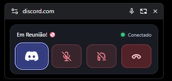
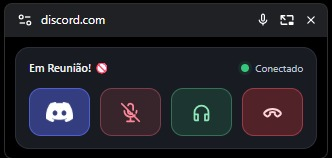
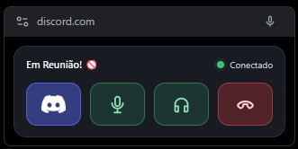

<div align="center">

# Discontrol

**Sua chamada de voz sempre ao alcance de um clique.**

Uma extensão leve para controlar chamadas do **Discord Web** em uma janela flutuante, sem precisar alternar constantemente de aba.

[](https://github.com/vsantus/discontrol)
[](https://www.google.com/chrome/)
[](https://www.typescriptlang.org/)
[](./LICENSE)

**[Como instalar](#-instalação)** · **[Funcionalidades](#-funcionalidades)** · **[Como usar](#-como-usar)** · **[Histórico](#-histórico-de-versões)**

</div>

---

## ✨ Conheça o Discontrol

O **Discontrol** traz os principais controles de uma chamada de voz para um painel compacto usando a **Document Picture-in-Picture API** do Chrome. Assim, você pode continuar programando, estudando ou navegando enquanto acompanha a conexão e controla o áudio do Discord Web.

A interface mostra o **canal atual à esquerda**, o **status da conexão à direita** e quatro ações rápidas: voltar ao Discord, ativar/desativar o microfone, ativar/desativar o áudio e desconectar.

### Prévia da interface

| Microfone e áudio desativados | Áudio ativo, microfone desativado | Microfone e áudio ativos |
| :---: | :---: | :---: |
|  |  |  |

> Os ícones de microfone e áudio refletem os estados detectados no Discord Web. As imagens representam três combinações possíveis.

## ⚡ Funcionalidades

| Recurso | Como funciona |
| --- | --- |
| **Janela flutuante** | O painel permanece visível sobre outras janelas por meio de Picture-in-Picture. |
| **Nome do canal** | Exibe o canal de voz conectado, quando identificado na interface do Discord. |
| **Status da chamada** | Indica conexão detectada, detecção parcial ou chamada não identificada. |
| **Microfone** | Ativa ou silencia o microfone com indicação visual do estado. |
| **Áudio** | Ativa ou silencia a saída de áudio do Discord, também com indicação visual. |
| **Desconectar** | Sai do canal de voz a partir do painel. |
| **Voltar ao Discord** | Retorna à aba original com um clique. |

## 📦 Instalação

### Opção 1 — Carregar a extensão pronta

1. Baixe e extraia o pacote `discontrol.zip` do projeto.
2. Abra `chrome://extensions` no Google Chrome.
3. Habilite o **Modo do desenvolvedor**.
4. Clique em **Carregar sem compactação**.
5. Selecione a pasta **`dist`**, que contém o arquivo `manifest.json`.
6. Fixe o Discontrol na barra de extensões para facilitar o acesso.

> **Importante:** selecione a pasta `dist`, e não o arquivo `.zip` ou a raiz do repositório.

### Opção 2 — Compilar a partir do código-fonte

**Pré-requisitos:** Node.js e npm instalados.

```bash
# Clone o projeto
git clone https://github.com/vsantus/discontrol.git
cd discontrol

# Instale as dependências e compile
npm install
npm run typecheck
npm run build
```

Depois, carregue a pasta `dist` gerada em `chrome://extensions`.

## 🎮 Como usar

1. Abra o [Discord Web](https://discord.com/app) no Chrome.
2. Entre em um canal de voz.
3. Clique no ícone do **Discontrol** na barra do navegador.
4. Controle sua chamada pela janela flutuante.

| Indicador | Significado |
| --- | --- |
| 🟢 Verde | Controles da chamada detectados. |
| 🟡 Amarelo | Detecção parcial dos controles. |
| ⚪ Cinza | Nenhuma chamada detectada. |

Os controles de microfone e fones ficam destacados conforme o estado identificado na página. Se algum controle não puder ser reconhecido, ele é desabilitado para evitar ações incorretas.

## 🛠️ Tecnologias

- **TypeScript** — implementação da extensão e sincronização dos controles.
- **Chrome Extensions Manifest V3** — integração com o navegador.
- **Document Picture-in-Picture API** — janela flutuante.
- **DOM API e MutationObserver** — observação da interface do Discord Web.

O projeto não precisa de backend, banco de dados ou conta adicional.

## ⚠️ Requisitos e limitações

- Requer **Google Chrome 116 ou superior**.
- Funciona **apenas no Discord Web**, não no aplicativo desktop.
- A aba original do Discord precisa permanecer aberta enquanto o PiP estiver em uso.
- A integração utiliza elementos e atributos acessíveis da página. Mudanças na interface ou no idioma do Discord podem exigir manutenção.
- O nome do canal pode aparecer como indisponível quando a extensão não conseguir identificá-lo com segurança.
- A extensão não implementa telemetria própria nem precisa enviar informações da chamada a servidores externos.

## 🗒️ Histórico de versões

| Versão | Principais mudanças |
| --- | --- |
| **0.6.3** | Correção da identificação do nome do canal pelo campo `Canal / Servidor`. |
| **0.6.2** | Nome do canal à esquerda e status da chamada à direita. |
| **0.6.1** | Correção do ícone de retorno ao Discord no PiP. |
| 0.6.0 | Identidade visual própria com monograma D e microfone desativado. |
| 0.5.0 | Rebranding do projeto para **Discontrol**, by devsantos. |
| 0.4.x | Interface minimalista, refinamento dos ícones e sincronização dos estados de microfone/áudio. |
| 0.3.x | Botões com ícones e evolução da detecção dos controles do Discord. |
| 0.2.x | Primeiros controles de chamada e ferramentas de diagnóstico. |
| 0.1.0 | Protótipo funcional de Picture-in-Picture. |

## 👨‍💻 Autor

Desenvolvido por **[devsantos](https://github.com/vsantus)**.

Gostou do projeto? Uma ⭐ no repositório ajuda outras pessoas a encontrá-lo.

## 📄 Licença e aviso legal

Distribuído sob a **[licença MIT](./LICENSE)**.

**Discontrol é um projeto independente e não é afiliado, patrocinado ou endossado pelo Discord.** Discord e suas marcas pertencem aos respectivos proprietários.